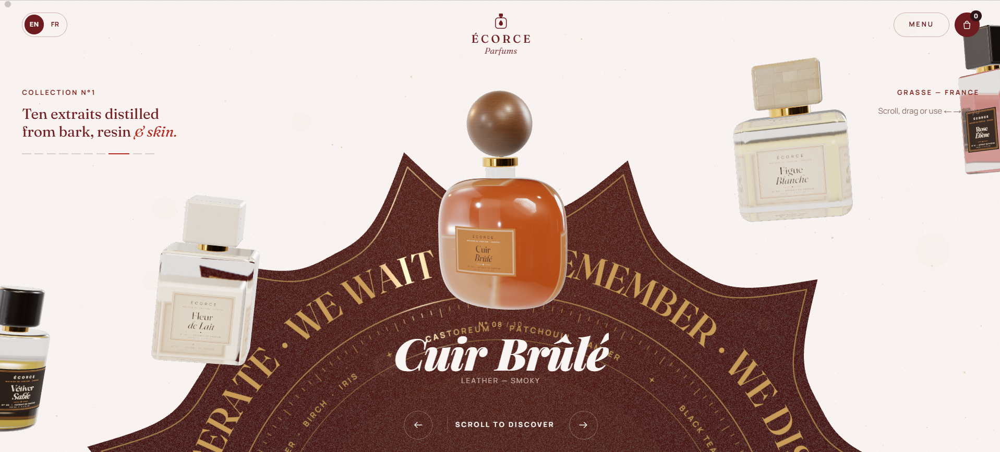
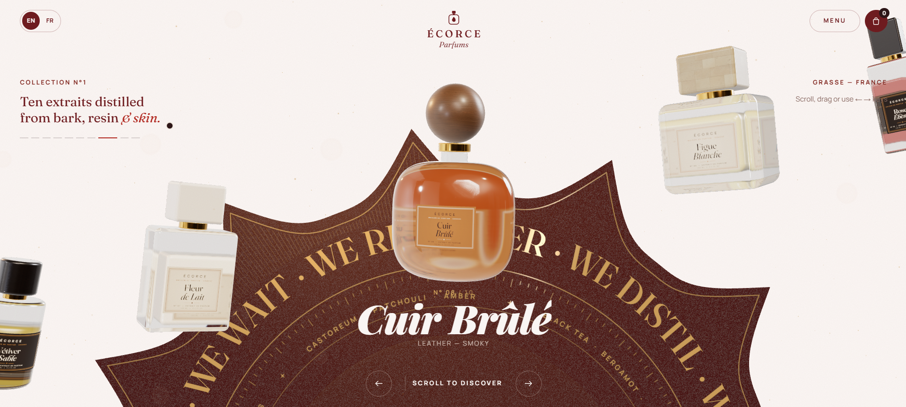
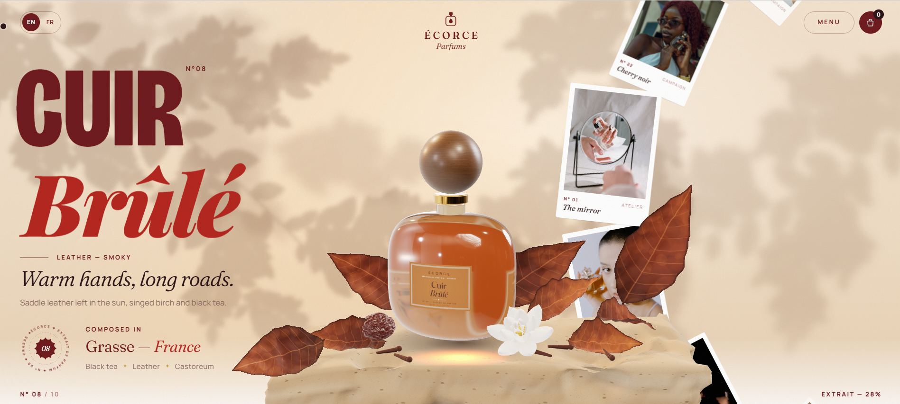
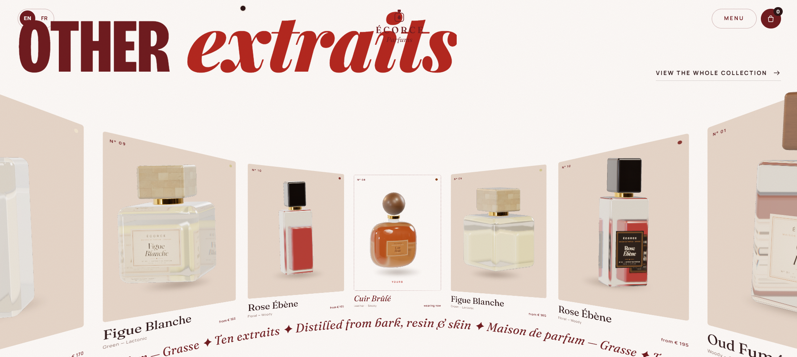
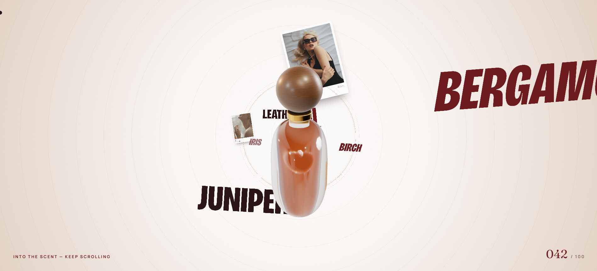
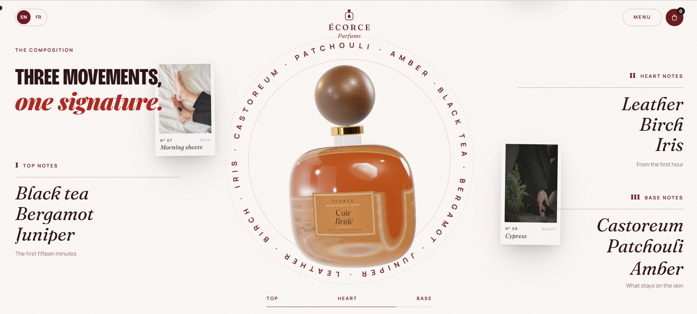
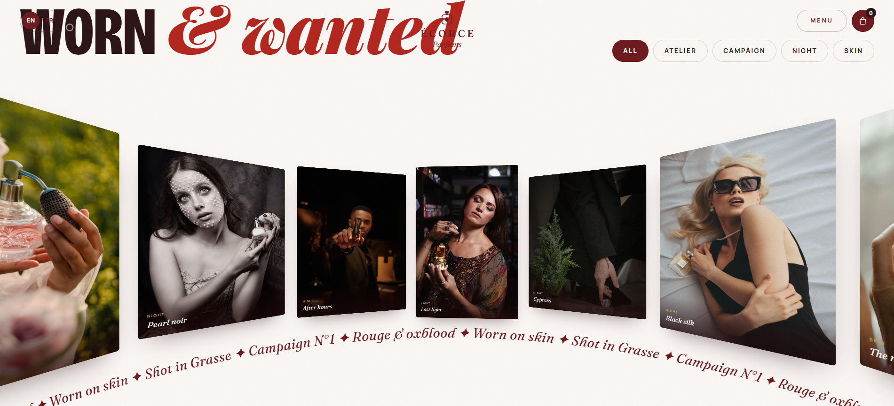

# ÉCORCE — Maison de Parfum · build showcase

A scroll-driven perfume website concept (UI study, all commerce is dummy). This repo shows **what it looks like, how it was designed, the prompts used to build it, and the pseudocode of the key ideas**.

> The source code lives in a separate private repository and is intentionally **not** included here.

**Stack (high level):** Next.js · React · three.js (React Three Fiber) · GSAP ScrollTrigger · Lenis smooth scroll

## Screenshots

**Home — bottle carousel over the star seal**

**Product page — still life hero, then scroll**

**Other extraits — full-width draggable arc**

**Into the scent — 3D word tunnel**

**The composition — notes orbiting the bottle**

**Worn & wanted — campaign photo arc**

## Read next

- [DESIGN.md](DESIGN.md) — palette, type, layout, motion language, how the pieces fit
- [PROMPTS.md](PROMPTS.md) — how to prompt an AI assistant to build a site like this, step by step
- [PSEUDOCODE.md](PSEUDOCODE.md) — the key mechanisms in plain-language pseudocode

## Credits

Studio HDRI and wood/marble textures: Poly Haven (CC0). Campaign photos: free-licence Pexels/Unsplash stock (credited in the private repo). Fonts: Fraunces and Manrope (SIL OFL). This is an unaffiliated concept; the page flow was inspired by a reference site's scroll experience.
